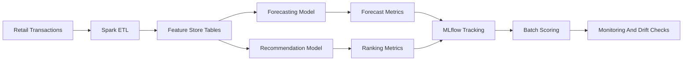

# Retail Forecasting And Recommendation Systems

Retail ML portfolio project showing demand forecasting, collaborative filtering, feature engineering, experiment tracking, and drift monitoring.

This repository uses synthetic or public retail-style data only.

## What This Demonstrates

- Forecasting pipelines for SKU-level demand
- Collaborative filtering and recommendation systems
- PySpark feature engineering patterns
- Experiment tracking and reproducibility
- Model drift monitoring
- Business metric framing for retail ML

## Architecture



## Features

- Synthetic transaction data generator
- Demand forecasting baseline
- Collaborative filtering recommender baseline
- Spark-style feature engineering notes
- Experiment tracking structure
- Drift monitoring checklist
- Business metric reporting

## Tech Stack

- Python
- PySpark
- Pandas
- Scikit-learn
- MLflow
- Airflow-style orchestration
- AWS SageMaker deployment notes

## Suggested Repository Topics

`machine-learning`, `forecasting`, `recommendation-system`, `pyspark`, `mlflow`, `airflow`, `sagemaker`, `retail-analytics`

## Quickstart

```bash
python -m venv .venv
.venv\Scripts\activate
pip install -r requirements.txt
python generate_data.py
python train_forecast.py
python train_recommender.py
```

## Example Metrics

```json
{
  "forecasting": {
    "metric": "weighted_mape",
    "baseline": 0.214,
    "model": 0.173
  },
  "recommendations": {
    "precision_at_10": 0.184,
    "coverage": 0.72
  }
}
```

## Evaluation

- Weighted MAPE
- RMSE
- Precision at K
- Catalog coverage
- Drift score
- Batch runtime

## Responsible AI And Security

- Uses synthetic or public data only
- Avoids customer PII
- Documents feature assumptions
- Separates credentials from source code

## Recruiter Signal

This project connects my Walmart experience to concrete ML engineering skills: forecasting, recommenders, PySpark ETL, MLOps, and measurable business outcomes.

