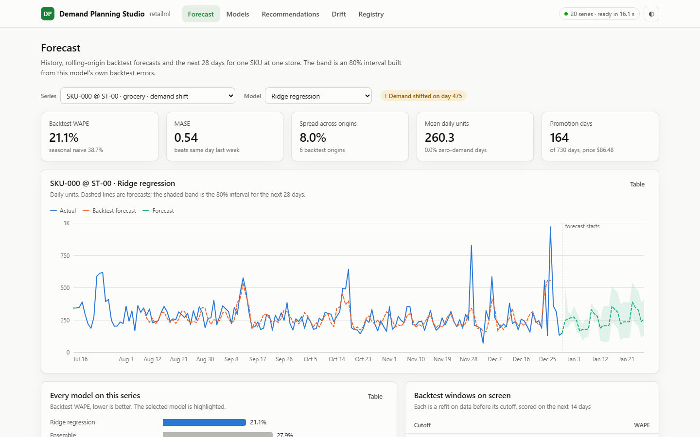
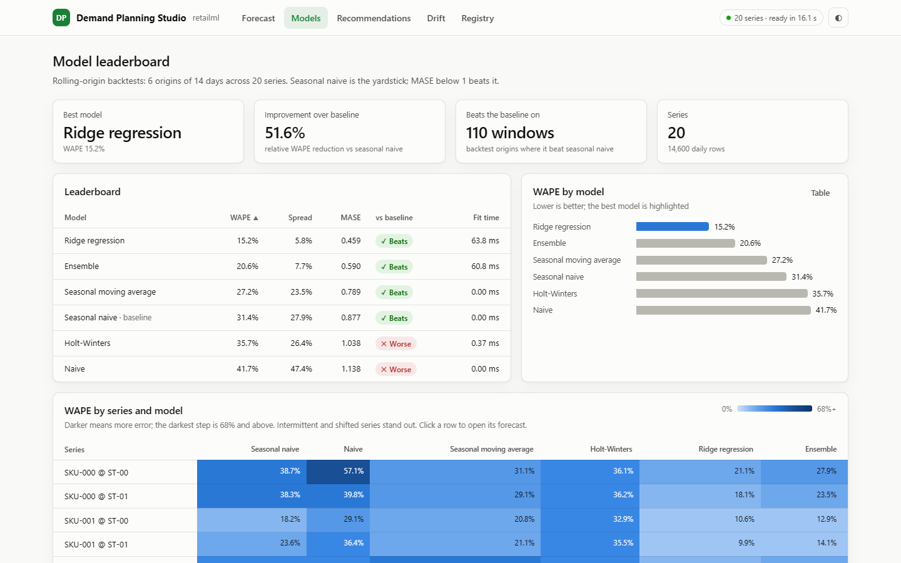

# Retail Forecasting and Recommender

Demand forecasting and collaborative filtering with the parts that decide
whether either is trustworthy: leakage-proof features, rolling-origin
backtesting, drift detection, experiment tracking and gated retraining.

[](https://github.com/Akarshanagoud/retail-forecasting-recommender/actions/workflows/ci.yml)


**Docs:** [Architecture and use cases](docs/ARCHITECTURE.md) · [Verified results](docs/RESULTS.md)

```bash
pip install -e ".[dev]"
retailml backtest          # rolling-origin model comparison
retailml evaluate-reco     # recommender vs the bestseller baseline
python examples/quickstart.py
```

No cluster, no API keys, no downloads. The core has zero runtime dependencies;
scikit-learn, PySpark, MLflow and Airflow are optional adapters, all free.

---

## What it produces

```
$ retailml backtest --skus 10 --stores 2 --days 730 --origins 6

MODEL                        SERIES     WAPE    STDEV    MASE  BEATS SN   FIT ms
--------------------------------------------------------------------------------
ridge                            20   0.1516   0.0580   0.459       110    53.28
ensemble                         20   0.2056   0.0774   0.590       102   108.31
seasonal_moving_average          20   0.2722   0.2353   0.789        82     0.00
seasonal_naive                   20   0.3135   0.2790   0.877        74     0.00
holt_winters                     20   0.3568   0.2642   1.038        54     0.20
naive                            20   0.4174   0.4744   1.138        57     0.00

best: ridge (51.6% better WAPE than seasonal naive)
```

`MASE` below 1.0 means the model beats "same day last week". `STDEV` is the
spread across rolling origins — a low mean with a high spread is a coin flip,
not a deployable model, and reporting only the mean hides exactly that.

```
$ retailml evaluate-reco --skus 40 --customers 1200

MODEL                   PREC@10   RECALL     MAP    NDCG     HIT  COVERAGE  NOVELTY
-----------------------------------------------------------------------------------
item-item CF             0.1069   0.7079  0.3088  0.4229  0.7964    1.0000    5.325
popularity               0.0442   0.2762  0.0996  0.1524  0.3573    0.6000    5.208
```

Both tables are CI gates. If the feature model stops beating seasonal naive, or
the recommender stops beating the bestseller list, the build fails.

---

## The five decisions that matter

### 1. Leakage is prevented structurally, then proved empirically

Leakage is the defining failure of time-series ML and it is almost never
deliberate — it arrives through a rolling mean computed before the split, or a
lag of zero on a target-derived column. The model scores beautifully in
backtest and falls over in production, and the backtest stays green.

Two defences, neither of which is a warning comment:

```python
FeatureConfig(lags=(0, 1))
# ValueError: target lags must be >= 1: a lag of 0 is the target itself,
# which is leakage
```

```python
assert_no_leakage(series)   # perturbs a future target, asserts no earlier row changed
```

The second is the one that counts: it tests behaviour, not intent, so it
catches leakage a code review would miss. It runs in CI and it is a hard gate
upstream of every training task in the Airflow DAG.

### 2. The metric is the modelling decision

MAPE is undefined on zero-demand days, and retail is full of them — slow movers
are exactly the SKUs where forecasting is hard, so a metric that quietly drops
them reports on the easy subset. MAPE is also asymmetric: over-forecasting caps
at 100% error, under-forecasting is unbounded, so optimising it biases
forecasts low, which in retail means stockouts.

| Metric | Why it is here |
|---|---|
| **WAPE** | The headline. Defined at zero, weighted by volume |
| **MASE** | Scaled against seasonal naive, so it compares across series of any size |
| **Bias** | A forecast can have great MAE and a persistent bias; only bias shows as overstock |
| **Pinball loss** | A forecast consumed as a stocking level has asymmetric costs |
| **Coverage** | A nominal 80% interval covering 40% of actuals is broken, not wide |
| **Zero fraction** | Context for whether MAPE was usable at all |

Cross-series WAPE is recomputed from totals, not averaged — an average of
ratios is not the ratio of totals, and only the latter means anything when
series have different volumes. There is a test for exactly that.

### 3. Baselines are the yardstick, not decoration

A gradient boosting model at 4% WAPE is impressive until seasonal naive scores
4.2% on the same series, at which point the model is a retraining pipeline
bought for nothing. Every model is scored against `SeasonalNaive`, and MASE
reports the ratio directly.

Holt-Winters and ridge regression are implemented directly rather than
imported — both are short enough to be readable, and having the seasonal
decomposition and the regularisation path in the repo makes them inspectable.
A scikit-learn adapter handles the models where reimplementation would prove
nothing.

Details that decide whether they work: Holt-Winters uses **multiplicative**
seasonality (Saturday is Tuesday times 1.4, not plus 40 units) with a **damped**
trend, because an undamped trend extrapolated 28 days out produces absurd
forecasts. Ridge is regularised because the feature matrix is deliberately
collinear — day-of-week dummies, lags at 1/7/14 and rolling means all encode
overlapping information, and unregularised OLS on that swings wildly between
retrainings.

### 4. Recommender accuracy alone is a trap

Showing everyone the top ten sellers scores respectably on recall, because most
purchases *are* of popular items — while being commercially useless. So
coverage and novelty are reported alongside accuracy:

- **Coverage** — a recommender touching 4% of the catalogue is a bestseller
  list with extra steps.
- **Novelty** — mean self-information of what was recommended. This is the
  entire commercial case for having a recommender.

Two corrections decide whether item-item CF works at all: **popularity
damping** (raw cosine makes the bestseller everyone's nearest neighbour, so
every list collapses to the same items) and **inverse user frequency** (a
200-item basket says much less about any pair within it than a three-item one).
The damping exponent is a tunable trade between accuracy and coverage, and both
sides are measured.

Splits are temporal. A random split lets the model learn from a customer's
future to predict their past.

### 5. Drift detection is not a retraining trigger

Data drift is an early warning; performance drift is evidence. Retraining on
data drift alone is how teams end up retraining weekly for no measured benefit
— inputs shift constantly and the model is usually fine.

```
overall verdict: drifted
performance    : drifted (+55.0% vs baseline error)
FEATURE                           PSI       KS  VERDICT
rolling_mean_28                0.4821   0.3910  drifted
lag_7                          0.1204   0.1830  watch
price                          0.0221   0.0640  stable
```

The policy requires **evidence and improvement**:

```python
should_retrain(drift, model_age_days=12, has_production_model=True)
# one drifted feature -> no retrain (usually a pipeline hiccup)
# three or more, or performance drift, or 30 days old -> retrain

evaluate_candidate(candidate_error=0.299, incumbent_error=0.300)
# not promoted: improvement 0.3% is below the 2% promotion gate
```

That gate is the point. Without a margin, ordinary run-to-run variance promotes
a new model about half the time and production becomes a random walk with a
changelog. There is also an absolute ceiling, because beating a broken
incumbent is not a reason to ship.

PSI and KS are implemented from the definitions rather than imported: PSI is
very sensitive to bin count and to how empty bins are handled, and a library
call hides exactly the choice that determines whether it fires. Bins are at
reference *quantiles*, not equal width, because equal-width bins on a
long-tailed price distribution put 95% of the mass in one bin and measure
nothing.

---

## Synthetic data with structure worth modelling

Real retail data cannot ship in a public repo, and a random walk teaches
nothing — a forecaster that beats noise has proved nothing. The generator
produces the structure that actually makes retail hard:

multiplicative weekly seasonality · annual seasonality and holiday spikes ·
price elasticity · promotions with a **pull-forward effect** (the week after a
promotion is depressed, so models treating promotions as a simple lift get the
following week wrong) · intermittent demand with many zero days · a mid-series
regime change for drift detection to find.

Everything is seeded and reproducible. The presence of that structure is itself
tested — if the generator stops producing learnable signal, the build fails.

---

## Usage

### Demand planning studio

```bash
pip install -e ".[server]"
retailml ui                    # opens http://127.0.0.1:8769/ui/
```



The studio backtests every model on every series in the background at start-up and
shows its progress, then serves:

- **Forecast**: one SKU at one store with its backtest windows, the next 28 days and
  an 80% interval from that model's own backtest errors, plus every model's WAPE on
  that series.
- **Models**: the leaderboard against seasonal naive, and WAPE for every series and
  model as a heat map, so intermittent and shifted series stand out.
- **Recommendations**: explainable item-item suggestions per customer ("because they
  bought…") next to the bestseller baseline, with offline evaluation.
- **Drift**: PSI and KS per feature, performance drift, and the retraining decision
  the policy makes from them.
- **Registry**: train a candidate, then try to promote it through the 2% gate.



### CLI

```bash
retailml generate --days 730 --out data/
retailml leakage-check --series 8
retailml backtest --models seasonal_naive,holt_winters,ridge,ensemble --origins 6
retailml recommend --customer CUST-0001 -k 10
retailml evaluate-reco --min-ndcg-lift 0.05
retailml drift --baseline-error 0.20 --recent-error 0.31
retailml retrain
retailml runs && retailml registry
```

Exit codes: `0` fine, `1` a quality gate failed or drift was detected, `2` usage.

```python
from retailml import generate_dataset, backtest_series, SeasonalNaive, RidgeRegression

dataset = generate_dataset(n_skus=12, n_stores=3, days=730)
result = backtest_series(
    dataset.series("SKU-000", "ST-00"), lambda: RidgeRegression(alpha=5.0)
)
result.mean_wape      # averaged across rolling origins
result.wape_stdev     # the spread that decides whether it is deployable
result.mean_mase      # below 1.0 beats seasonal naive
```

---

## Orchestration

`airflow/dags/retail_ml_pipeline.py` defines the daily pipeline:

```
generate -> validate -> leakage_check -> build_features
                                              |
                +-----------------------------+------------------+
           backtest_models              detect_drift      train_recommender
                |                             |                  |
                +-------------+---------------+                  |
                              |                          evaluate_recommender
                     decide_retraining
                              |
                  [promote_model | skip_promotion] -> publish
```

The logic lives in the `retailml` package and the DAG only orchestrates — a
pipeline whose business logic sits inside `PythonOperator` callables can only
be tested by running Airflow, which means in practice it is not tested. Here
the module imports cleanly without Airflow, `validate_graph()` proves the graph
is acyclic and fully wired, and a test asserts that `backtest_models` is
unreachable without passing the leakage gate.

Optional integrations, all free: **PySpark** for feature engineering at scale,
**MLflow** as a drop-in for the built-in tracker (it runs against a local file
store with no server — worth knowing before standing up infrastructure), and
**scikit-learn** for gradient boosting inside the same backtest.

---

## Project layout

```
src/retailml/
  data.py            Synthetic generator with real retail structure
  metrics.py         WAPE, MASE, pinball, bias, coverage, aggregation
  features.py        Leakage-proof features + the empirical leakage proof
  backtest.py        Rolling-origin evaluation and model comparison
  drift.py           PSI, KS, performance drift, verdicts
  tracking.py        Experiment tracker and gated model registry
  retraining.py      Trigger policy and promotion decisions
  cli.py             generate / backtest / recommend / drift / retrain / ui
  server.py          Studio API: backtests, forecasts, recommendations, drift, registry
  web/               Studio front end: static HTML, CSS and JS, no build step
  forecasting/       Baselines, Holt-Winters, ridge, ensemble, sklearn adapter
  recommender/       Item-item CF, popularity baseline, evaluation
airflow/dags/        The daily pipeline
.github/scripts/     CI quality gates
tests/               126 tests
```

## Testing

```bash
pytest                       # 117 tests, ~6 seconds
retailml leakage-check
ruff check src tests airflow
```

CI enforces what the README claims: leakage-free features, ridge beating
seasonal naive with MASE below 1.0, the recommender beating popularity by at
least 5% NDCG, drift detection firing on injected decay, and a valid DAG graph.

## Limitations

- The data is synthetic. The numbers demonstrate that the pipeline and the
  metrics work; they say nothing about accuracy on a real catalogue.
- Forecasts are point forecasts with damped trends. Prediction intervals are
  scored (`coverage`) but not produced by the built-in models — add a quantile
  model if you need stocking levels rather than expected demand.
- The recommender is item-item collaborative filtering only. No content
  features, no session context, no bandit for exploration.
- Drift thresholds (PSI 0.1/0.25) are the conventional values, not values
  calibrated on this data. Calibrate against your own false-alarm tolerance.
- Everything runs in-process. PySpark and Airflow adapters exist, but this is
  not a distributed training system.

## License

MIT
