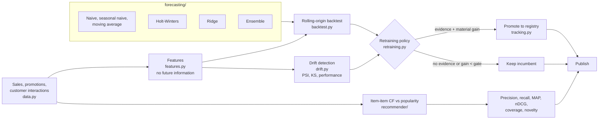
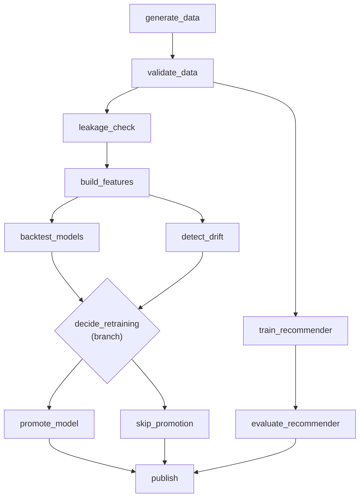

# Architecture and use cases

## System overview

A daily pipeline builds leakage-proof features, backtests forecasting models
against baselines, checks for drift, and decides whether to retrain. A promotion
gate controls what reaches production, and a separate branch trains and
evaluates the recommender.

## The daily DAG

The Airflow DAG in `airflow/dags/retail_ml_pipeline.py` runs on schedule
`0 3 * * *` with one active run at a time. Its dependency graph is validated
for cycles by `validate_graph()`.

## Components

| Module | Responsibility |
|---|---|
| `data.py` | Synthetic generator with seasonality, intermittent demand and promotions |
| `metrics.py` | WAPE, MASE, pinball loss, bias, coverage and aggregation |
| `features.py` | Leakage-proof features and an empirical leakage proof |
| `backtest.py` | Rolling-origin evaluation and model comparison against baselines |
| `forecasting/` | Baselines, Holt-Winters, ridge, ensemble and a scikit-learn adapter |
| `recommender/` | Item-item collaborative filtering, popularity baseline, evaluation |
| `drift.py` | PSI, KS, performance drift and verdicts |
| `retraining.py` | Trigger policy (`should_retrain`) and promotion gate (`evaluate_candidate`) |
| `tracking.py` | Experiment tracker and gated model registry |
| `cli.py` | `generate`, `backtest`, `recommend`, `drift`, `retrain` |

## Use cases

| Use case | Who | How it helps |
|---|---|---|
| Forecast SKU-store demand | Demand planner or supply chain team | Models are scored on WAPE and MASE against "same day last week" |
| Know whether a model is actually better | Data scientist | Backtests report spread across origins, so a lucky mean is visible |
| Prove features do not leak the future | ML reviewer | Perturbing a future target changes no earlier feature row |
| Handle intermittent and promotional demand | Retail analytics | The synthetic data and metrics reflect zero-demand days and price elasticity |
| Recommend products with a reason | Merchandising or e-commerce | Item-item CF gives "because you bought X, Y" explanations |
| Judge a recommender beyond accuracy | Product owner | Reports coverage and novelty next to precision and recall |
| Decide when to retrain | MLOps engineer | Retraining needs drift or performance evidence, not a calendar |
| Avoid promoting a marginal model | Platform owner | A candidate must beat the incumbent by at least 2% to be promoted |
| Trace every model to its run | Auditor | The tracker records runs, a data fingerprint and the git commit |
| Run the pipeline on a schedule | Data engineer | A ready-made Airflow DAG with a branching retrain decision |
